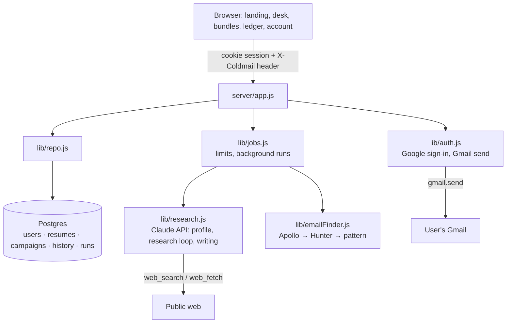

# How the hosted version works

## A search, step by step

1. **Profile.** The resume PDF goes to Claude with a JSON schema and comes back as a structured profile (projects, experience, topic tags, signature). This is cached per resume.
2. **Research.** An agent loop on `claude-opus-5-5` with Anthropic's server-side web search and web fetch, plus one tool of ours: `save_person`. Each call is checked (it must have a name, a company and a source URL, and must not be a duplicate or someone already emailed) and written into the bundle straight away. That's what drives the live tracker. People already in the bundle or already emailed are passed in as an exclusion list.
3. **Emails.** Anyone without a public address goes through Apollo, then Hunter, then a name-pattern guess, using the server's keys.
4. **Writing.** One structured call writes a subject and body for every new person, featuring the resume items that match their work.

Every write to a bundle happens in a transaction with a row lock (`repo.updateCampaign`), so the research job and the user's own edits never overwrite each other. "Add people" reuses the same steps with the existing bundle.

## Safety and limits

- **Sessions:** random tokens in an HttpOnly cookie; only their SHA-256 hash is stored.
- **Requests:** every API route is scoped to the signed-in user. Requests that change data need a custom header other sites can't send.
- **Gmail:** send-only (`gmail.send`). The refresh token is encrypted with AES-256-GCM. Nothing is sent until the user approves a postcard and confirms the send.
- **Limits:** searches per user per month, sends per user per day, and searches running at once across all users. A failed search doesn't count against the monthly allowance, and a failed new bundle is removed.
- **Account deletion:** cascades through every table and revokes Gmail.
