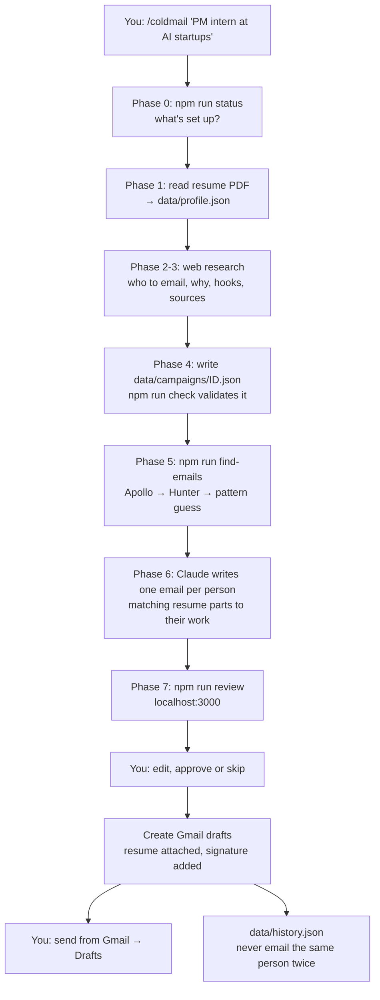

# How it works

## The big idea: brain, hands, memory

The project has three parts that never call each other directly. They only share files.

| Part | What it is | Job |
|---|---|---|
| **Brain** | Claude Code running `/coldmail` (`.claude/commands/coldmail.md`) | Anything that needs judgment: reading your resume, deciding who to target, researching people on the web, writing emails. |
| **Hands** | Small Node.js scripts (`scripts/`, `lib/`, `server/`) | Anything mechanical that must be exact: calling Apollo/Hunter, checking files, showing the review page, building emails and putting them in Gmail. |
| **Memory** | JSON files in `data/` | The shared notebook. The brain writes research and drafts into it; the hands read it, add to it, and act on it. |

Why split it this way? The AI part costs nothing because it runs on your Claude Pro plan through Claude Code, and the scripts are free. When you ship this as a product later, you replace only the brain (Claude Code → the Claude API on a server). The hands and memory stay almost the same.

## The flow

Steps 1–6 happen inside Claude Code. Steps 7 onward happen on the review page.

You can start step 1 two ways: type `/coldmail ...` in Claude Code, or use the **+ new** tab on the review page. The tab asks the server to run Claude Code headless (`claude -p "/coldmail ..."`, see `lib/runs.js`). That uses your Claude Pro login, runs the same playbook, and streams each step back. The server turns those steps into the tracking timeline (resume read → researching → finding emails → writing → ready). Each run's log is kept in `data/runs/`.

## What each part does

### The brain: `.claude/commands/coldmail.md`
This file is a **set of instructions**, not code. Typing `/coldmail ...` in Claude Code hands Claude this playbook with your words filled in. It tells Claude:
- what shape the files must be (so the scripts can read them),
- research rules: only real people, confirmed current role, every fact backed by a source URL,
- email-writing rules: 80–150 words, open with something specific about them, feature the 1–2 resume items that match *their* work, no signature,
- when to call which script.

To change how emails are written or who gets targeted, edit this file. No code changes needed.

### The memory: `data/`
| File | Written by | Contains |
|---|---|---|
| `resume/*.pdf` | you | your resume(s) |
| `profile.json` | Claude (Phase 1) | your resume as structured data: projects, experience, skills, each with topic **tags** (security, fintech, ml...) plus your **signature** |
| `campaigns/<id>.json` | Claude, then scripts, then the review page | one search: the target role and a list of contacts. Each contact has who they are, why they fit, **hooks** (specific facts to mention), sources, email + how confident we are in it, the subject and body, and a status |
| `history.json` | draft step | everyone you've drafted an email to, so later campaigns skip them |
| `style-examples.md` | you (optional) | emails you liked, so Claude copies your tone |
| `google-*.json` | Google setup | your Gmail login (secret, never shared) |

A contact moves through **statuses**: `pending` (waiting for review) → `approved` / `skipped` → `drafted` (in Gmail, locked).

Its **email confidence** (`emailStatus`) is one of:
- `public`: Claude saw it written on a real page (`emailSourceUrl` proves it)
- `verified`: Apollo/Hunter say it's deliverable
- `likely`: Apollo/Hunter returned it without verifying
- `manual`: you typed it in
- `guessed`: built from a name pattern, no proof
- `not_found`

### The hands

**`lib/store.js`**: the only code that reads and writes the JSON files. It also handles "have I emailed this person before?" (same email, or same name at the same company) and picks which resume to attach.

**`scripts/check-campaign.js`** (`npm run check`): a quality gate for Claude's output. Claude is good but not perfect, so after it writes a campaign, this script checks it and Claude fixes whatever fails. It looks for missing fields, a `public` email without a source URL, duplicates, people already emailed, placeholders like `[Company]`, and emails that are too long.

**`lib/emailFinder.js` + `scripts/find-emails.js`** (`npm run find-emails`): fills in emails using the trust order we agreed on:
1. Claude found it publicly → keep it, spend nothing.
2. Otherwise ask **Apollo** (people-match API).
3. Otherwise ask **Hunter** (email-finder API).
4. Otherwise **guess** from patterns (`first@`, `first.last@`, `flast@`...) and keep the other patterns as one-click alternatives on the review page. With `--verify-guesses`, Hunter's verifier checks the top guess.

It saves after every person, so if it crashes halfway, the credits you already spent aren't lost.

**`server/review.js` + `server/public/`** (`npm run review`): a tiny web server that runs only on your laptop, plus the page you see. The page is one HTML file with a poster-style landing page and five sections (new bundle, desk, bundles, ledger, setup) behind a left sidebar. It switches between them with the address-bar hash (`#/desk`), cross-fading via the browser's View Transitions API. The page asks the server for the campaign. Your edits autosave back into the campaign file, and the buttons change statuses. The server re-reads the file on every request, so if Claude edits a campaign while the page is open, a refresh shows the change. It won't let you approve someone without a valid email, or edit someone already in Gmail. Every request that changes something must carry a header only this page sends, so other websites open in your browser can't poke the local server. The setup tab's resume upload saves PDFs into `data/resume/`.

**`lib/google.js` + `scripts/gmail-auth.js`** (`npm run auth`): logs into Google. Your browser opens Google's sign-in page, you approve, and Google sends a one-time code back to a small temporary server on your laptop. That code is exchanged for a **refresh token** saved in `data/google-token.json`. From then on, the tool trades the refresh token for short-lived access tokens on its own. The permission requested is `gmail.compose`, which can create drafts but can't read your mail.

**`lib/mime.js`**: builds the actual email. An email with an attachment is a text file in a format called MIME: headers (From, To, Subject), then a "part" for the body text, then a "part" for the PDF encoded as text (base64). This file also adds your signature to every body, so links and contact details are always identical and Claude can't mistype them.

**`lib/drafts.js`** (the **Create Gmail drafts** button, or `npm run drafts`): for each approved contact, it builds the MIME email with the resume attached, sends it to Gmail's `drafts.create` API, marks the contact `drafted`, and adds them to `history.json`. It **never sends**. You always press send yourself.

**`scripts/merge-contacts.js`** (`npm run merge`): how Claude adds people to a bundle you may be reviewing at the same time. Instead of rewriting the whole campaign file (which could wipe out an approval you just made), Claude writes only the new people to a scratch file and this script appends them with the next free ids. It skips duplicates and anyone already emailed, and never changes a card you've approved, set aside or sent. The **+ add people** button on the desk starts a run in this mode (`/coldmail more <N> for <bundle-id>`), and only the new people use Hunter credits.

**`lib/runs.js`**: starts and stops the headless Claude run for the **+ new** tab. It allows only the tools the playbook needs (reading/writing files, web search, and the `npm run status/check/find-emails` scripts), so the run can't do anything else on your computer. It works out the current phase from which tools Claude is using.

**`scripts/status.js`** (`npm run status`): the setup checklist. Claude runs it first so it knows what's missing.

## Design decisions worth knowing

- **Drafts, not sending.** You stay the final check, nothing goes out by accident, and the emails come from your real Gmail like normal messages.
- **Sources for everything.** Every person and hook has a URL, so on the review page you can check that Claude didn't make anything up before you send.
- **Plain JSON files, no database.** It's easy to open and read, Claude can edit the files directly, and it's enough for one user. A database comes later, when there are many users.
- **No npm packages.** Node 22+ already has `fetch`, an HTTP server and crypto built in, so there's nothing to install or keep updated.
- **The signature is added by code, not written by AI.** Exact links every time.

## Going from personal tool to product (later)

| Today | Product version |
|---|---|
| Claude Code + `/coldmail` | Claude API (with its web search tool) running the same playbook on a server, as a background job |
| JSON files in `data/` | a database (e.g. Postgres) with one row per user, campaign and contact |
| Local review page | the same page, hosted, with user login |
| Your own Google Cloud app in Testing mode | a verified Google app (needs Google's review for Gmail permissions) |
| Your Apollo/Hunter keys | your company's keys, with usage limits per user |
