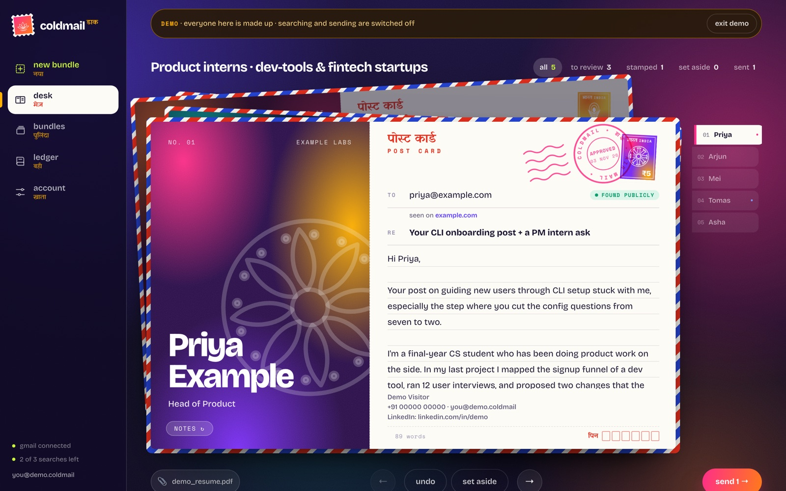

<div align="center">

# coldmail <sup>डाक</sup> · website edition

**Personal cold emails, hand-delivered**, as a multi-user web app.

**[▶ Try the live demo](https://coldmail-cpw0.onrender.com/?demo)** · [Website](https://coldmail-cpw0.onrender.com) · [Full project overview](https://github.com/shataksha45-shiiii/Cold-Mail#readme) · [Deploy your own](DEPLOY.md)



</div>

This branch is the hosted version of coldmail: what runs at [coldmail-cpw0.onrender.com](https://coldmail-cpw0.onrender.com). For the story, screenshots and design decisions, see the [project overview](https://github.com/shataksha45-shiiii/Cold-Mail#readme). The laptop edition lives on [`main`](https://github.com/shataksha45-shiiii/Cold-Mail/tree/main).

## What the website does

1. **Sign in with Google.** Visitors get a demo with made-up people; real use is invite-only (`ALLOWED_EMAILS`).
2. **account**: upload a resume; Claude reads it into a profile. Add your signature and example emails ("your voice").
3. **+ new bundle**: describe who you want to reach. The search runs and a live Speed Post tracker shows each step.
4. **desk**: flip through the postcards; edit, **approve** or **set aside**. **+ add people** grows the bundle.
5. **Connect Gmail** once (send-only) and **send**. Each email goes out from your account with your resume attached.
6. **ledger**: a register of everything you've sent, so you never email anyone twice.

## Where searches run

| Who | Engine | Cost |
|---|---|---|
| The owner (`ADMIN_EMAILS`) | **Laptop helper**: `npm run helper` on the `main` branch runs the search with Claude Code and streams progress back | Free (owner's Claude plan); laptop must be on during a search |
| Invited users | **Claude API** agent (web search + fetch, `save_person` tool, structured writing) | Pay-per-use; only if `ANTHROPIC_API_KEY` is set |
| Visitors | **Demo**: runs in the browser from `public/demo.json` | Free; searching and sending are off |

## Stack

Node.js (no framework) · PostgreSQL (Neon; PGlite locally) · Claude API / Claude Code · Google OAuth 2.0 + Gmail API (`gmail.send`) · Hunter / Apollo · vanilla JS/CSS · Render.

## Run or deploy

- **Deploy for free** (Render + Neon + Google OAuth): [DEPLOY.md](DEPLOY.md)
- **Locally:**
  ```bash
  git checkout product && npm install
  cp .env.example .env   # SESSION_SECRET, Google client, optional keys
  npm run dev            # uses a built-in database in data/dev-db
  ```

## How it's built

[ARCHITECTURE.md](ARCHITECTURE.md) covers the request flow, the research pipeline, the laptop queue, row-locked bundle edits and the security model.

## Limits

Per user: 3 searches a month on the API (owner unlimited), up to 20 people per laptop search or 15 per API search, and 50 emails a day. Nothing is sent without the user approving it and confirming.

## License

[MIT](LICENSE)
